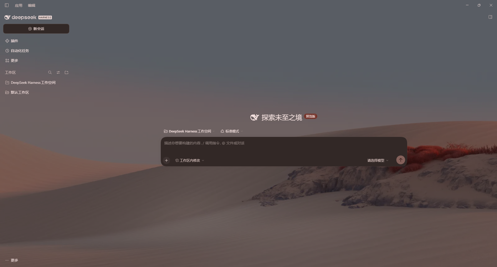
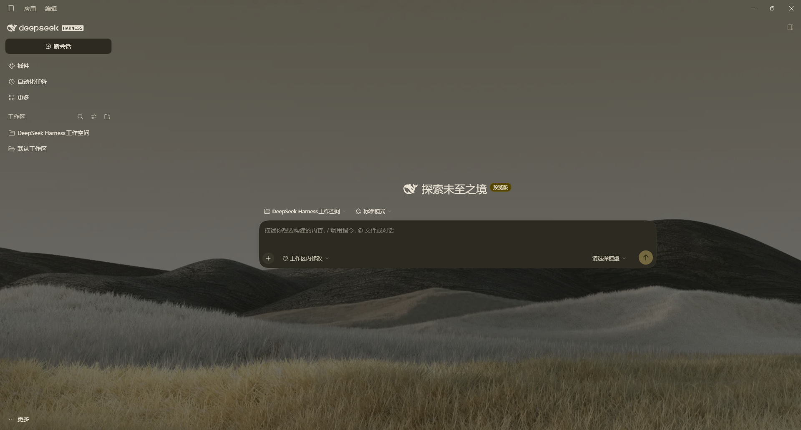
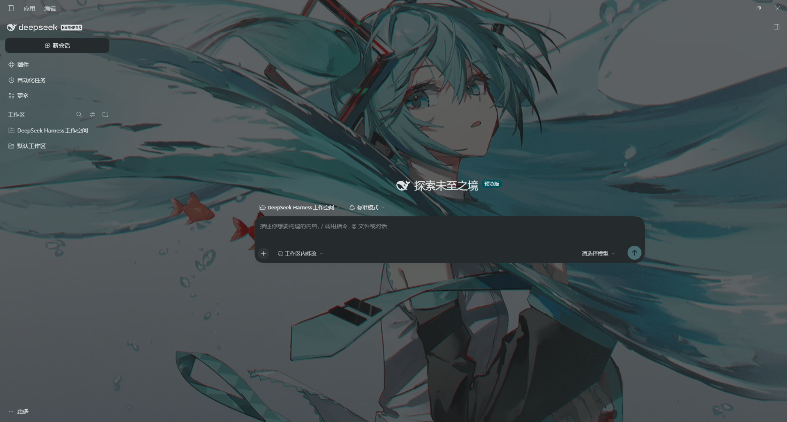
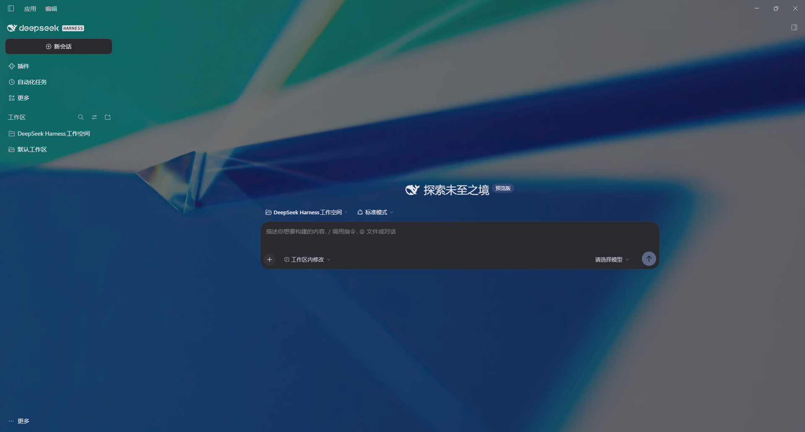
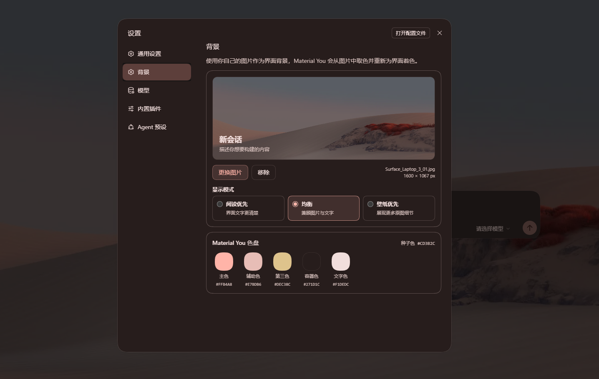
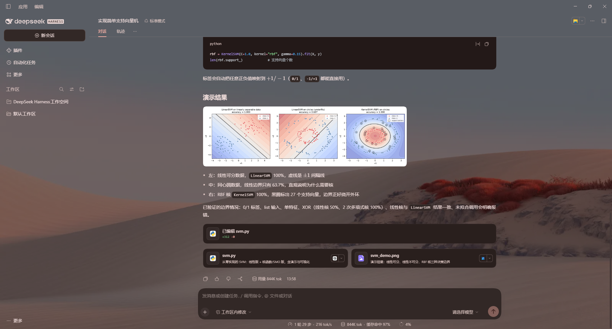

# DeepSeek Harness 主题背景

为 **DeepSeek Harness** 设置自定义全窗背景。从壁纸提取种子色，用 Google **Material Design 3（Material You / 莫奈）** 生成浅色和深色配色。

## 安装

在 DSH 打开 **插件 → 添加插件**，输入 `github:banka2101/dsh-theme-background#v1.1.0`，安装后启用。也可以下载 [发行安装包](https://github.com/banka2101/dsh-theme-background/releases/latest)，在同一入口填入 `.tgz` 的完整路径。

到 **设置 → 背景** 上传图片，选择「阅读优先」「均衡」或「壁纸优先」。

适用于 DSH `0.2.2` 系列，从 `0.2.2-rc.1` 起。已在 Windows 桌面版验证。

## 效果展示

| 草原 | 插画 | 抽象 |
| --- | --- | --- |
|  |  |  |

| 背景设置 | 会话效果 |
| --- | --- |
|  |  |

## Agent README

把仓库链接发给 DeepSeek Harness Agent，请它按 [Agent 安装指南](AGENT_README.md) 安装。

[MIT](LICENSE) · [Material Color Utilities 许可](LICENSE-MATERIAL-COLOR-UTILITIES)
